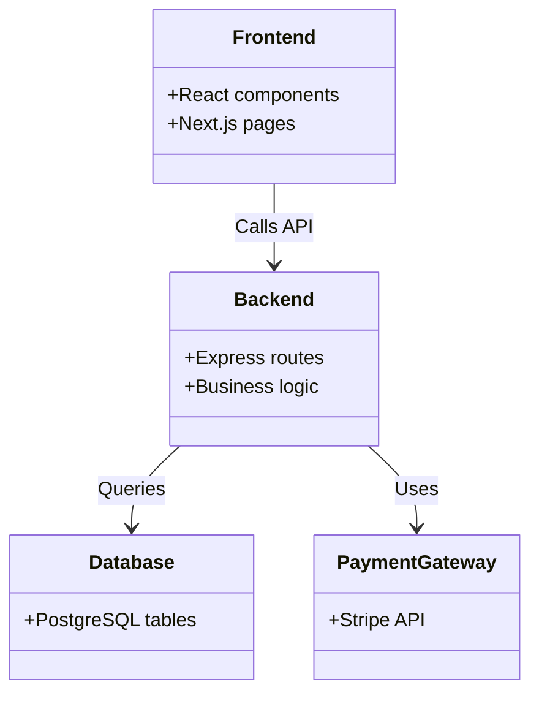

# Tech Architecture

## Overview
Describe the high‑level system architecture for ANUKOOL, including major services, databases, APIs, and integrations.

## Components
- Frontend (React)
- Backend (Node.js / Express)
- Database (PostgreSQL)
- Payment Gateway (Stripe)
- External APIs (Shopify, Mailchimp, etc.)

## Diagram

## Links to Research
- [Technical Research](file:///Users/sachin/CATCH/separated_projects/DELIVERABLES/ANUKOOL_product_research/tech_research.md)
